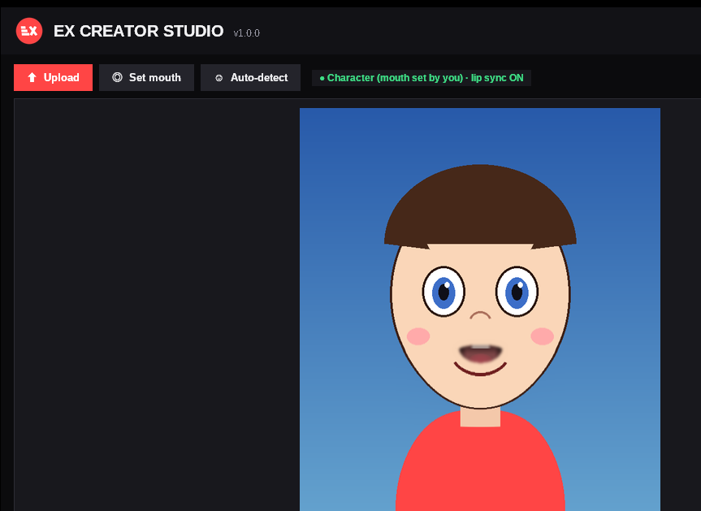
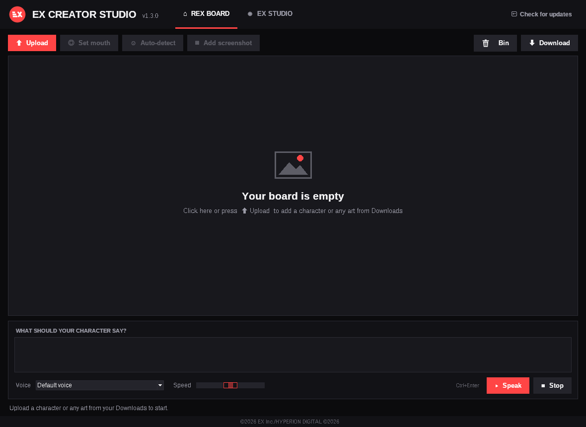
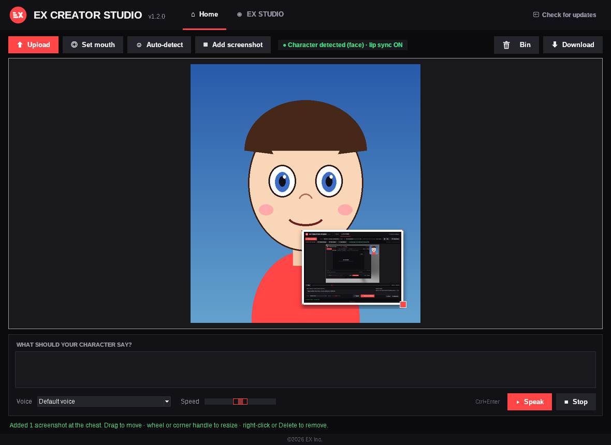
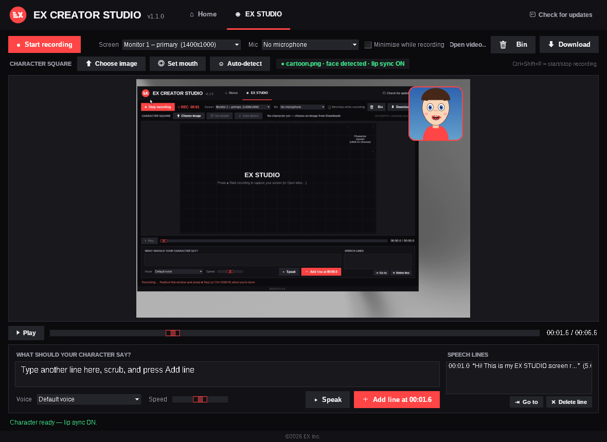

# EX CREATOR STUDIO

One board. Any character or art. Type what it should say: EX CREATOR STUDIO speaks it with an offline Windows voice and lip-syncs the character's mouth to it. Then download the result as an MP4.

The **REX BOARD** shows one character or piece of art. It is the screen the app opens on, and it starts empty.

## Features
- **Upload** a character or any art (png, jpg, jpeg, webp, gif, bmp). The picker opens in your Downloads folder. The board stays empty until you upload something.
- **Auto character detection.** OpenCV finds anime/cartoon faces (lbpcascade_animeface) and real faces (Haar frontal face). It then locates the mouth inside the face. If no face is found, the image is shown as art with no lip sync.
- **Set mouth.** Click the mouth, or drag a box around it, so any character can talk. Right-click marks the image as art, and Esc finishes.
- **Speak.** Offline SAPI5 text-to-speech uses your installed Windows voices, with a speed setting. The voice plays while the mouth moves in sync.
- **Bin.** Clears the board: image, text, and the generated audio and video.
- **Download.** Renders the lip-sync animation and the voice into an H.264/AAC MP4. It saves to `Downloads\EX CREATOR STUDIO <date time>.mp4`.
- **Check for updates.** Reads `latest.json` from this repo and installs newer versions.

## New in 1.3.0
- The main board (the one the app opens on) is now called **REX BOARD**. It works exactly the same: the app still opens on it and it starts empty.
- Updates now come from [Teobokki/ex-creator-studio](https://github.com/Teobokki/ex-creator-studio/releases).

## Screenshots on the board - new in 1.2.0
- **Add screenshot** (REX BOARD toolbar) opens Downloads. You can pick one or several png/jpg/webp/bmp files.
- Each screenshot is pinned in front of the character's chest, with a white border and a shadow. **Drag** it anywhere. **Mouse wheel** over it, or drag the red corner handle, to resize. **Right-click** gives Bring to front, Bigger, Smaller and Remove; **Delete** removes the selected one.
- Lip sync keeps working underneath. **Download** includes the screenshots where you placed them, and **Bin** clears them.

(The cartoon and the pinned screenshot in this image are test images.)

## EX STUDIO (screen recorder) - new in 1.1.0
REX BOARD stays the screen the app opens on. Switch to the **EX STUDIO** tab to use the recorder.
- **Record:** choose the full desktop or one monitor, and optionally a microphone, then press **Start recording**. A red REC timer runs while you record. The app can minimise itself while recording; restore it and press Stop, or press **Ctrl+Shift+R** anywhere. Capture uses the bundled ffmpeg (gdigrab) at 30 fps H.264.
- **Character square:** a webcam-style rounded square in the top-right. Choose an image from Downloads, and auto mouth detection and **Set mouth** work the same as on the REX BOARD.
- **Make it talk:** after recording, the video plays in the preview. Scrub to a moment, type in the box under the screen, and press **Add line** (or **Speak** to preview). Lines are listed with their time, and you can delete them.
- **Download:** saves `Downloads\EX STUDIO <date time>.mp4`. It contains the recording with the character square lip-syncing during each line (mouth closed otherwise) and the TTS mixed with any mic audio.
- **Bin:** clears the recording, the character and the lines.

## How lip sync works
The typed text is rendered to a WAV with SAPI5. For each video frame (30 fps) the app measures the voice's loudness (RMS, noise-gated, compressed, with attack/release smoothing) to decide how far the mouth opens. It measures spectral brightness to decide its width: "ee/s" sounds are wider and "oo" sounds are rounder. The mouth is animated by warping the lower lip and jaw down with a smooth displacement field and lifting the upper lip slightly. A soft-edged mouth interior (shadow, teeth, tongue) is blended into the gap. Live preview and the exported MP4 use the same frames.

## Build
Python 3.11 + PyInstaller (onedir) + Inno Setup. `numpy==1.26.4`, `opencv-python-headless==4.10.0.84`, `pillow`, `imageio-ffmpeg`, `comtypes`.

©2026 EX Inc./HYPERION DIGITAL ©2026
