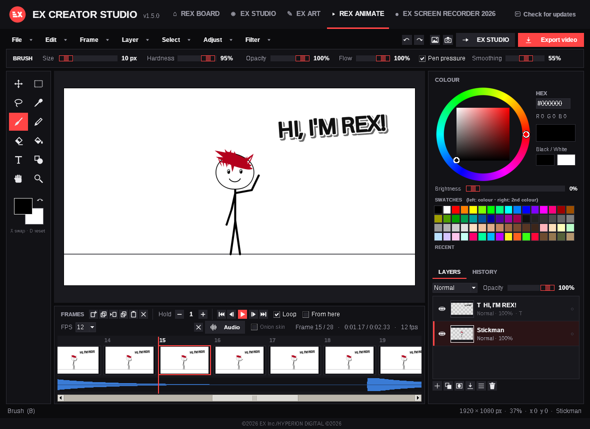
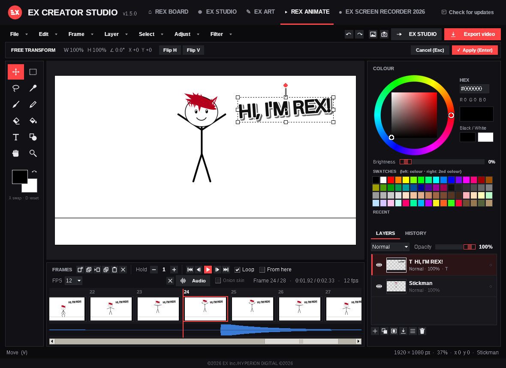
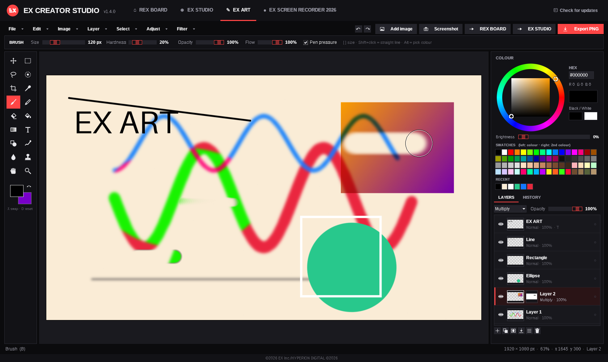
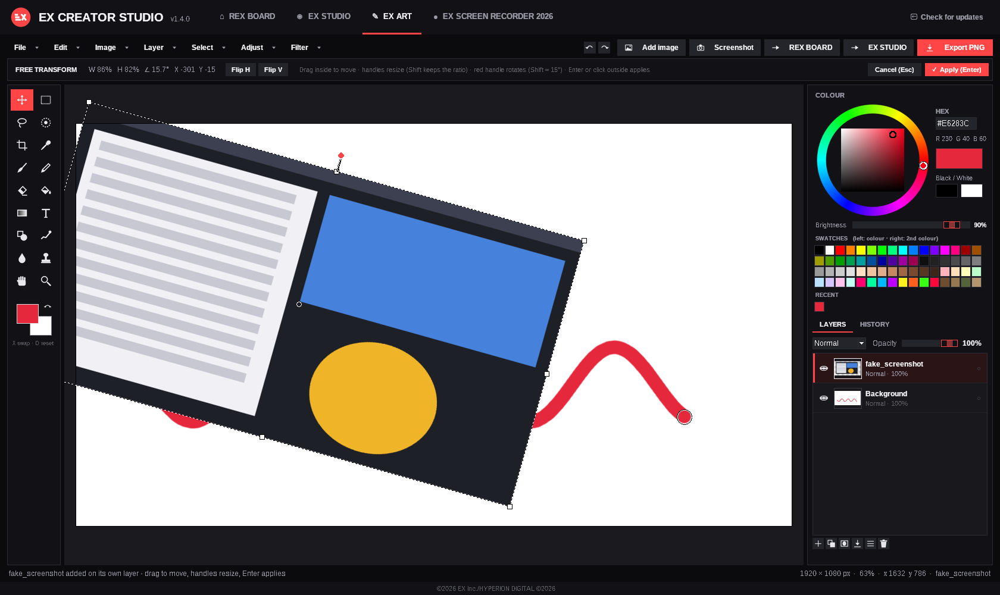
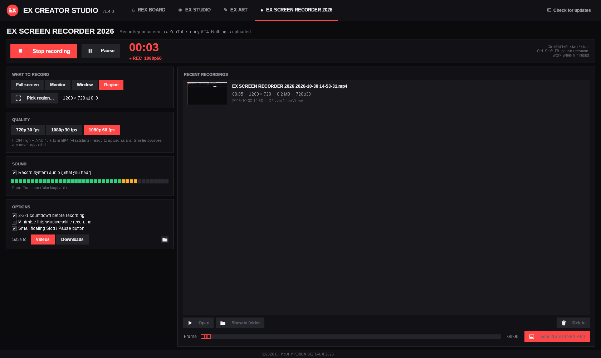

# EX CREATOR STUDIO

One board. Any character or art. Type what it should say: EX CREATOR STUDIO speaks it with an offline Windows voice and lip-syncs the character's mouth to it. Then download the result as an MP4.

The **REX BOARD** shows one character or piece of art. It is the screen the app opens on, and it starts empty.

## Features
- **Upload** a character or any art (png, jpg, jpeg, webp, gif, bmp). The picker opens in your Downloads folder. The board stays empty until you upload something.
- **Auto character detection.** OpenCV finds anime/cartoon faces (lbpcascade_animeface) and real faces (Haar frontal face). It then locates the mouth inside the face. If no face is found, the image is shown as art with no lip sync.
- **Set mouth.** Click the mouth, or drag a box around it, so any character can talk. Right-click marks the image as art, and Esc finishes.
- **Speak.** Offline SAPI5 text-to-speech uses your installed Windows voices, with a speed setting. The voice plays while the mouth moves in sync.
- **Bin.** Clears the board: image, text, and the generated audio and video.
- **Download.** Renders the lip-sync animation and the voice into an H.264/AAC MP4. It saves to `Downloads\EX CREATOR STUDIO <date time>.mp4`.
- **Check for updates.** Reads `latest.json` from this repo and installs newer versions.

## New in 1.5.0
### REX ANIMATE - frame-by-frame 2D animation
Open the **REX ANIMATE** tab to turn stickman drawings into a video.
- **Canvas:** white by default. Presets are 1920×1080 (the default), 1080×1920 vertical and 1080×1080 square.
- **Timeline:** a strip of frames with thumbnails. You can add, duplicate, insert a blank, delete, copy and paste frames, and drag them to reorder. **Hold** shows one drawing for N frames: use the − / + buttons or double-click a frame.
- **Playback:** 6, 8, 12, 24 or 30 fps (12 is the default), with Play / Pause (P), Loop and *From here*. Step with the buttons or the **,** and **.** keys; Home and End jump to the first and last frame.
- **Layers:** each frame has up to 5 drawing layers with visibility, opacity, lock and reorder. Text layers don't count toward the 5. A shared **background** (a colour or an image) sits under every frame.
- **Tools:** brush and pen with **Smoothing** (a stabiliser), pencil, eraser and fill. The lasso can move, scale and rotate a selection. Line, rectangle and ellipse shapes, the eyedropper, zoom and pan work as in EX ART.
- **Colour wheel:** the same one as EX ART. It has an HSV wheel and square, brightness down to 0, hex input, 64 swatches (black and white first) and recent colours. Black is the default.
- **Text:** font, size, colour, bold, outline and colour, and drop shadow. Text stays **editable**: move, resize and rotate it with the Move tool, and double-click to change it. It can stay on a **range of frames**, which suits titles and captions.
- **Import:** drop or paste (Ctrl+V) images and screenshots onto a frame, then move and resize them. You can also set a background image.
- **Audio:** add an MP3 or WAV track. It shows as a waveform on the timeline and plays with the animation. Scrub the waveform for frame-accurate sound.
- **Export:** MP4 (H.264, plus AAC when there is audio) at 1080p or 720p, a GIF, or a PNG sequence, saved to Videos or Downloads. *Smooth video* writes a standard 24 / 30 fps file that holds each drawing. **EX STUDIO** sends the video straight to EX STUDIO.
- **Projects:** `.rexanim` files store frames, layers, text, background and audio. Autosave runs every 2 minutes (File → Recover autosave), and each frame has its own undo / redo.
- **Sample:** File → *Open the sample*. REX, the red-haired stickman, walks in, waves and jumps.
- Onion skin is off by default; a small toggle on the timeline turns it on.

## New in 1.4.0
### EX ART - a layered image editor
Open the **EX ART** tab to paint, edit photos and lay out thumbnails.
- **Canvas:** 1920×1080, 1080×1080, 4K, HD, portrait, A4 or a custom size. The background is white by default; black, transparent or your second colour are options. Opens PNG, JPG and WEBP.
- **Layers:** add, delete, duplicate, rename, drag to reorder, hide, lock, opacity, and blend modes (Normal, Multiply, Screen, Overlay, Add, Darken, Lighten). Also merge down, flatten and layer masks.
- **Tools** (with shortcuts):
  - Move (V), Marquee (M), Lasso (L), Selection brush (Q), Crop (C), Eyedropper (I).
  - Brush (B), Pencil (N), Eraser (E), Fill with tolerance (G), Gradient (Shift+G), Text (T), Shapes (U).
  - Smudge (R), Blur/Sharpen (Shift+R), Clone stamp (S), Hand (H or Space-drag), Zoom (Z or the mouse wheel).
  - The brush has size, hardness, opacity and flow, and uses pen pressure with Windows Ink pens.
- **Colour:**
  - HSV ring and square (reaches pure black and pure white), hex input and a brightness slider down to 0.
  - Primary and secondary colours; black is the primary and white the secondary by default.
  - 64 swatches, black and white first, then the full spectrum, greys, skin tones, pastels and neons. Recent colours are kept too.
- **Adjust and Filter:** brightness/contrast, hue/saturation, levels, invert, grayscale, Gaussian blur, sharpen, noise, and cinematic looks (Teal & Orange, Noir, Warm Film, Cold Night, Faded Matte, Bleach Bypass, Golden Hour).
- **Transform:** free transform (Ctrl+T), flip, rotate and resize the canvas. Undo/redo keeps 80 steps (Ctrl+Z / Ctrl+Y), and a History panel lets you click back to any step.
- **Files:** save a `.exart` project with all its layers (Ctrl+S). Export PNG, JPG or transparent PNG to Pictures or Downloads, or send the picture to REX BOARD or EX STUDIO.

**Screenshots and images on the canvas.** There are several ways to put a screenshot or image on the canvas; each one goes on its own new layer:
- **Add image** (several files at once).
- Drag files from Explorer onto the canvas.
- **Ctrl+V**, for example after PrtScn or Win+Shift+S.
- The **Screenshot** button.

How to adjust a placed image:
- **Move and resize:** drag inside the box to move it. Drag a corner or side handle to resize; Shift keeps the aspect ratio.
- **Rotate:** drag the red handle (Shift snaps to 15°).
- **Apply:** press Enter or click outside the box.
- **Later changes:** click the image again with the Move tool to move or resize it.

### EX SCREEN RECORDER 2026
A new tab that records your screen to a YouTube-ready MP4 (H.264 High + AAC 48 kHz, +faststart).
- **What to record:** the full screen, one monitor, one window or a region you drag out.
- **Quality:** 720p30, 1080p30 or 1080p60. Smaller sources are never upscaled.
- **Sound:** system audio only (what you hear, via WASAPI loopback), with an on/off toggle and a level meter. A microphone is never recorded.
- **Controls:**
  - An optional 3-2-1 countdown, Pause/Resume and a recording timer.
  - A small floating Stop/Pause button that is kept out of the video on Windows 10 2004 and later.
  - Global hotkeys that also work while the app is minimised: **Ctrl+Shift+R** starts or stops, and **Ctrl+Shift+F9** pauses or resumes.
- **Saving:** recordings go to **Videos** or **Downloads** as `EX SCREEN RECORDER 2026 <date time>.mp4`.
- **Recent recordings:** the list has Open, Show in folder and Delete, plus **Send frame to EX ART**.
- Nothing is ever uploaded.

## New in 1.3.0
- The main board (the one the app opens on) is now called **REX BOARD**. It works exactly the same: the app still opens on it and it starts empty.
- Updates now come from [Teobokki/ex-creator-studio](https://github.com/Teobokki/ex-creator-studio/releases).

## Screenshots on the board - new in 1.2.0
- **Add screenshot** (REX BOARD toolbar) opens Downloads. You can pick one or several png/jpg/webp/bmp files.
- Each screenshot is pinned in front of the character's chest, with a white border and a shadow. **Drag** it anywhere. **Mouse wheel** over it, or drag the red corner handle, to resize. **Right-click** gives Bring to front, Bigger, Smaller and Remove; **Delete** removes the selected one.
- Lip sync keeps working underneath. **Download** includes the screenshots where you placed them, and **Bin** clears them.

(The cartoon and the pinned screenshot in this image are test images.)

## EX STUDIO (screen recorder) - new in 1.1.0
REX BOARD stays the screen the app opens on. Switch to the **EX STUDIO** tab to use the recorder.
- **Record:** choose the full desktop or one monitor, and optionally a microphone, then press **Start recording**. A red REC timer runs while you record. The app can minimise itself while recording; restore it and press Stop, or press **Ctrl+Shift+R** anywhere. Capture uses the bundled ffmpeg (gdigrab) at 30 fps H.264.
- **Character square:** a webcam-style rounded square in the top-right. Choose an image from Downloads, and auto mouth detection and **Set mouth** work the same as on the REX BOARD.
- **Make it talk:** after recording, the video plays in the preview. Scrub to a moment, type in the box under the screen, and press **Add line** (or **Speak** to preview). Lines are listed with their time, and you can delete them.
- **Download:** saves `Downloads\EX STUDIO <date time>.mp4`. It contains the recording with the character square lip-syncing during each line (mouth closed otherwise) and the TTS mixed with any mic audio.
- **Bin:** clears the recording, the character and the lines.

## How lip sync works
The typed text is rendered to a WAV with SAPI5. For each video frame (30 fps) the app measures the voice's loudness (RMS, noise-gated, compressed, with attack/release smoothing) to decide how far the mouth opens. It measures spectral brightness to decide its width: "ee/s" sounds are wider and "oo" sounds are rounder. The mouth is animated by warping the lower lip and jaw down with a smooth displacement field and lifting the upper lip slightly. A soft-edged mouth interior (shadow, teeth, tongue) is blended into the gap. Live preview and the exported MP4 use the same frames.

## Build
Python 3.11 + PyInstaller (onedir) + Inno Setup. `numpy==1.26.4`, `opencv-python-headless==4.10.0.84`, `pillow`, `imageio-ffmpeg`, `comtypes`.

©2026 EX Inc./HYPERION DIGITAL ©2026
